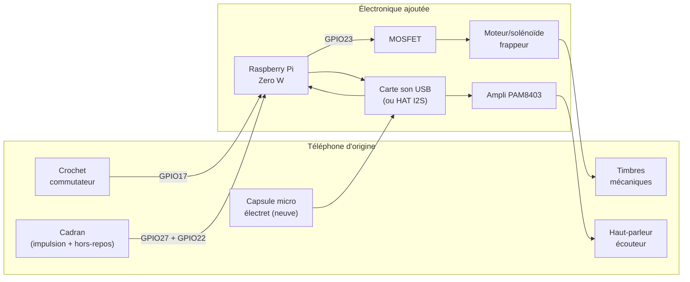

# Modifications matérielles

## Ce qu'on garde / ce qu'on remplace

| Élément d'origine | Décision | Pourquoi |
|---|---|---|
| Boîtier, combiné (mécanique), cadran, crochet commutateur | **Conservés tels quels** | Aspect et toucher d'origine préservés |
| Micro à charbon (dans le combiné) | **Remplacé** par une capsule électret | Le micro carbone demande une polarisation DC particulière, incompatible avec une entrée son moderne |
| Écouteur (bobine dans le combiné) | À **mesurer** — réutilisable si son impédance est compatible avec la sortie de l'ampli, sinon remplacé par un petit haut-parleur 8 Ω | Évite de casser une pièce d'origine si elle peut être réutilisée |
| Timbres mécaniques (les deux cloches) | **Conservés**, mais leurs bobines d'origine (~90 V AC / 25 Hz) sont débranchées | Trop dangereux/complexe à régénérer en toute sécurité pour 6 postes |
| — | **Ajout** d'un petit moteur vibrant ou solénoïde qui vient frapper mécaniquement les timbres | Reproduit le vrai son des cloches sans haute tension |
| Câblage interne (induction, batterie locale) | **Retiré** | Remplacé entièrement par le Raspberry Pi + électronique moderne |
| — | **Ajout** Raspberry Pi Zero W + carte son + ampli + alimentation | Cerveau du poste |

> **Pourquoi le Zero W (original) plutôt que le Zero 2 W ?** Choix dicté
> par la disponibilité (le Zero 2 W était en rupture au moment du projet).
> Le Zero W a un seul cœur ARM11 (ARMv6) à 1 GHz au lieu d'un quad-cœur
> Cortex-A53 — largement suffisant ici puisque chaque poste ne gère
> qu'un seul appel SIP à la fois (pas de multi-appel/conférence en
> local). La seule vraie différence pratique : le Zero W est **32-bit
> uniquement** (ARMv6 ne supporte pas l'architecture 64-bit), donc il
> faut flasher **Raspberry Pi OS Lite en version 32-bit** et non 64-bit
> — voir `setup.md`. Le reste (brochage GPIO, code du daemon, config
> baresip/Ansible) est identique aux deux cartes.

## Connectique USB : pas de port USB-A sur le Zero W !

⚠️ Piège classique : le Pi Zero W n'a **aucun port USB-A**. Il a deux
ports **micro-USB** : un marqué "PWR IN" (alimentation uniquement, rien
ne s'y branche côté données) et un marqué "USB" (le seul port de
données, en mode OTG). La carte son USB (et l'adaptateur USB-Ethernet
optionnel) sont tous les deux en USB-A — il faut donc un intermédiaire :

- **Un seul périphérique USB à brancher (juste la carte son, cas le plus
  courant)** : un simple adaptateur/câble micro-USB OTG (USB-A femelle →
  micro-USB mâle) suffit, ex. [InLine Adaptateur Micro-USB OTG](https://www.galaxus.ch/fr/s1/product/inline-adaptateur-micro-usb-otg-usb-20-cable-usb-13265450) (~CHF 6-10).
- **Deux périphériques (carte son + adaptateur Ethernet)** : il faut un
  **hub OTG micro-USB multi-ports**, pas un simple adaptateur — ex.
  [InLine OTG Cardreader & 3-Port USB 2.0 Hub](https://www.galaxus.ch/fr/s1/product/inline-otg-cardreader-3-port-usb-20-hub-usb-20-speicherkartenlesegeraet-13274156).

Ce point n'était pas dans le BOM initial — voir `bom.md`, corrigé.

## Brochage GPIO (Raspberry Pi Zero W)

Numérotation **BCM**. À ajuster dans `gpio-daemon/config.example.yaml` et
dans l'inventaire Ansible si vous câblez différemment.

| Signal | GPIO (BCM) | Type | Notes |
|---|---|---|---|
| Crochet commutateur (hook) | GPIO17 | entrée, pull-up interne | fermé (décroché) = niveau bas |
| Cadran — contact d'impulsion | GPIO27 | entrée, pull-up interne | un front par impulsion pendant le retour du cadran |
| Cadran — contact "hors repos" (off-normal) | GPIO22 | entrée, pull-up interne | fermé pendant toute la durée où le cadran n'est pas au repos ; optionnel (voir ci-dessous) |
| Sortie frappeur de timbres | GPIO23 | sortie, vers MOSFET | pilote le moteur/solénoïde via un MOSFET (jamais directement, le GPIO ne fournit pas assez de courant) |

Si votre cadran n'a que **deux fils** (pas de contact "hors repos"
séparé), laissez `dial_off_normal: null` dans la config : le daemon
bascule automatiquement sur un décodage par **temporisation entre
impulsions** (`TimeoutDialDecoder`), légèrement moins robuste mais
fonctionnel — voir `gpio-daemon/gpio_daemon/dial_decoder.py`.

Tous les contacts mécaniques du téléphone (crochet, cadran) sont câblés
en tout-ou-rien entre le GPIO et la masse (GND) ; le pull-up interne du
Pi suffit, aucune résistance externe n'est nécessaire pour ces entrées.

## Schéma de principe

## Alimentation

- Le Raspberry Pi Zero W consomme peu (~0.5-1 W au repos, pics à ~1.5 W —
  encore moins que le Zero 2 W, son unique cœur ARM11 étant plus sobre)
  mais demande une alimentation 5V stable — utilisez un vrai bloc
  micro-USB 5V/2.5A, pas un chargeur de téléphone bas de gamme (chutes de
  tension = redémarrages aléatoires).
- Deux options :
  1. **Simple** : bloc secteur USB caché dans/derrière le boîtier, câble
     sortant discrètement par le trou de câble d'origine.
  2. **Plus propre pour une installation fixe (ex. salle d'escape game)** :
     alimentation par PoE via un splitter PoE→micro-USB (~10 €) et un câble
     Ethernet, qui apporte aussi le réseau filaire (recommandé si le Wi-Fi
     est saturé — voir `software-architecture.md`).

## Points à valider sur le premier prototype avant de dupliquer

1. **Impédance de l'écouteur d'origine** au multimètre — décide s'il est
   réutilisable tel quel derrière le PAM8403 ou s'il faut un
   haut-parleur de remplacement.
2. **Force nécessaire pour faire sonner les timbres** de façon audible
   sans les endommager — choisir le moteur/solénoïde en conséquence
   (commencer par un petit solénoïde 5V à faible course, ajuster si le
   son est trop faible).
3. **Espace disponible dans le boîtier** pour loger le Pi + carte son +
   ampli + MOSFET sans forcer sur les mécanismes d'origine.
