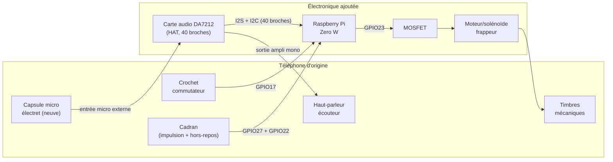

# Modifications matérielles

## Ce qu'on garde / ce qu'on remplace

| Élément d'origine | Décision | Pourquoi |
|---|---|---|
| Boîtier, combiné (mécanique), cadran, crochet commutateur | **Conservés tels quels** | Aspect et toucher d'origine préservés |
| Micro à charbon (dans le combiné) | **Remplacé** par une capsule électret, câblée sur l'entrée micro externe de la carte audio | Le micro carbone demande une polarisation DC particulière, incompatible avec une entrée son moderne |
| Écouteur (bobine dans le combiné) | À **mesurer** — réutilisable si son impédance est compatible avec la sortie ampli mono de la carte audio, sinon remplacé par un petit haut-parleur 8 Ω | Évite de casser une pièce d'origine si elle peut être réutilisée |
| Timbres mécaniques (les deux cloches) | **Conservés**, mais leurs bobines d'origine (~90 V AC / 25 Hz) sont débranchées | Trop dangereux/complexe à régénérer en toute sécurité pour 6 postes |
| — | **Ajout** d'un petit moteur vibrant ou solénoïde qui vient frapper mécaniquement les timbres | Reproduit le vrai son des cloches sans haute tension |
| Câblage interne (induction, batterie locale) | **Retiré** | Remplacé entièrement par le Raspberry Pi + électronique moderne |
| — | **Ajout** Raspberry Pi Zero W + carte audio DA7212 (HAT) + alimentation | Cerveau du poste |

> **Pourquoi le Zero W (original) plutôt que le Zero 2 W ?** Choix dicté
> par la disponibilité (le Zero 2 W était en rupture au moment du projet).
> Le Zero W a un seul cœur ARM11 (ARMv6) à 1 GHz au lieu d'un quad-cœur
> Cortex-A53 — largement suffisant ici puisque chaque poste ne gère
> qu'un seul appel SIP à la fois (pas de multi-appel/conférence en
> local). La seule vraie différence pratique : le Zero W est **32-bit
> uniquement** (ARMv6 ne supporte pas l'architecture 64-bit), donc il
> faut flasher **Raspberry Pi OS Lite en version 32-bit** et non 64-bit
> — voir `setup.md`. Le reste (brochage GPIO, code du daemon, config
> baresip/Ansible) est identique aux deux cartes.

## Interface audio : carte DA7212 (HAT I2S, recommandée)

Plutôt qu'une carte son USB + ampli séparé, le poste utilise une carte
**Waveshare DA7212 Audio Board (A)** : elle se branche directement sur
le connecteur 40 broches (I2S + I2C), sans passer par un port USB.
Analyse du schéma constructeur (`DA7212-Audio-Board-A-Schematics.pdf`) :

- **Entrée micro externe disponible**, séparée des deux micros embarqués
  sur la carte : le bloc "Headphones-MIC" expose une broche micro dédiée
  (câblée sur `MIC1_P` du DA7212). Les deux micros embarqués
  ("digital microphone 1/2") sont eux-mêmes chacun câblés via un petit
  connecteur 3 broches (OUT/GND/VDD) — probablement une capsule électret
  montée en module amovible plutôt que soudée à demeure.
  → **Câblage recommandé** : débrancher un des deux micros embarqués et
  câbler à sa place, sur ce même connecteur 3 broches, la capsule
  électret du combiné (fil plus long jusqu'à l'embouchure). Alternative
  si ce connecteur s'avère inadapté à l'usage : souder directement sur
  la broche micro du connecteur "Headphones-MIC".
  ⚠️ À confirmer avec la sérigraphie du PCB réel (wiki Waveshare) avant
  de souder — le schéma seul ne garantit pas l'emplacement physique exact.
- **Ampli dédié pour l'écouteur** : la carte a un ampli stéréo (`APA2068`,
  sortie casque/HP stéréo) **et** un "Mono amplifier" séparé avec son
  propre connecteur (`SP_N`/`SP_P`) — c'est ce dernier qu'il faut utiliser
  pour l'unique écouteur mono du combiné.
- **EEPROM embarqué** → chargement automatique du pilote par Raspberry Pi
  OS (pas de `dtoverlay` à configurer à la main), et **aucun conflit**
  avec les GPIO déjà utilisés par le daemon (crochet=17, cadran=27/22,
  sonnerie=23 — l'I2S/I2C utilise d'autres broches).

Cette carte **élimine le besoin d'adaptateur/hub OTG** pour l'audio (elle
ne passe pas par le port USB, qui de toute façon n'existe pas en USB-A
sur le Zero W). L'adaptateur OTG ne reste nécessaire que si vous ajoutez
en plus un adaptateur USB-Ethernet (voir `software-architecture.md`) —
dans ce cas, un simple adaptateur micro-USB OTG (USB-A femelle → micro-USB
mâle) suffit puisque l'unique périphérique USB à brancher est alors
l'Ethernet, ex. [InLine Adaptateur Micro-USB OTG](https://www.galaxus.ch/fr/s1/product/inline-adaptateur-micro-usb-otg-usb-20-cable-usb-13265450) (~CHF 6-10).

*(Alternative moins chère, si vous préférez éviter le HAT : carte son USB
+ ampli PAM8403 + capsule électret séparés — nécessite alors l'adaptateur/
hub OTG décrit ci-dessus pour la carte son. Voir l'historique du dépôt
pour cette variante.)*

## Brochage GPIO (Raspberry Pi Zero W)

Numérotation **BCM**. À ajuster dans `gpio-daemon/config.example.yaml` et
dans l'inventaire Ansible si vous câblez différemment.

| Signal | GPIO (BCM) | Type | Notes |
|---|---|---|---|
| Crochet commutateur (hook) | GPIO17 | entrée, pull-up interne | fermé (décroché) = niveau bas |
| Cadran — contact d'impulsion | GPIO27 | entrée, pull-up interne | un front par impulsion pendant le retour du cadran |
| Cadran — contact "hors repos" (off-normal) | GPIO22 | entrée, pull-up interne | fermé pendant toute la durée où le cadran n'est pas au repos ; optionnel (voir ci-dessous) |
| Sortie frappeur de timbres | GPIO23 | sortie, vers MOSFET | pilote le moteur/solénoïde via un MOSFET (jamais directement, le GPIO ne fournit pas assez de courant) |

Si votre cadran n'a que **deux fils** (pas de contact "hors repos"
séparé), laissez `dial_off_normal: null` dans la config : le daemon
bascule automatiquement sur un décodage par **temporisation entre
impulsions** (`TimeoutDialDecoder`), légèrement moins robuste mais
fonctionnel — voir `gpio-daemon/gpio_daemon/dial_decoder.py`.

Tous les contacts mécaniques du téléphone (crochet, cadran) sont câblés
en tout-ou-rien entre le GPIO et la masse (GND) ; le pull-up interne du
Pi suffit, aucune résistance externe n'est nécessaire pour ces entrées.

## Schéma de principe

## Alimentation

- Le Raspberry Pi Zero W consomme peu (~0.5-1 W au repos, pics à ~1.5 W —
  encore moins que le Zero 2 W, son unique cœur ARM11 étant plus sobre)
  mais demande une alimentation 5V stable — utilisez un vrai bloc
  micro-USB 5V/2.5A, pas un chargeur de téléphone bas de gamme (chutes de
  tension = redémarrages aléatoires).
- Deux options :
  1. **Simple** : bloc secteur USB caché dans/derrière le boîtier, câble
     sortant discrètement par le trou de câble d'origine.
  2. **Plus propre pour une installation fixe (ex. salle d'escape game)** :
     alimentation par PoE via un splitter PoE→micro-USB (~10 €) et un câble
     Ethernet, qui apporte aussi le réseau filaire (recommandé si le Wi-Fi
     est saturé — voir `software-architecture.md`).

## Points à valider sur le premier prototype avant de dupliquer

1. **Emplacement exact de l'entrée micro externe sur la carte DA7212** —
   comparer la sérigraphie du PCB reçu avec le schéma (connecteur 3
   broches d'un des deux micros embarqués, ou broche micro du connecteur
   "Headphones-MIC") avant de souder quoi que ce soit.
2. **Impédance de l'écouteur d'origine** au multimètre — décide s'il est
   réutilisable tel quel derrière l'ampli mono de la carte DA7212 ou
   s'il faut un haut-parleur de remplacement.
3. **Force nécessaire pour faire sonner les timbres** de façon audible
   sans les endommager — choisir le moteur/solénoïde en conséquence
   (commencer par un petit solénoïde 5V à faible course, ajuster si le
   son est trop faible).
4. **Espace disponible dans le boîtier** pour loger le Pi + carte DA7212
   (format HAT, plus grand que le Pi Zero lui-même) + MOSFET sans forcer
   sur les mécanismes d'origine.
