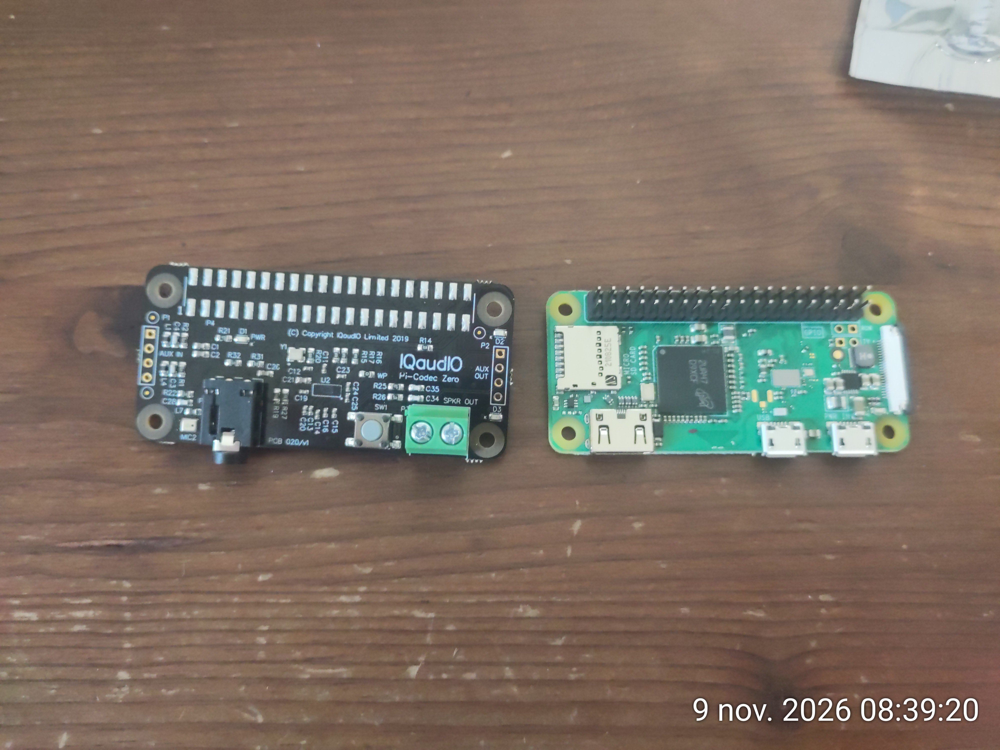
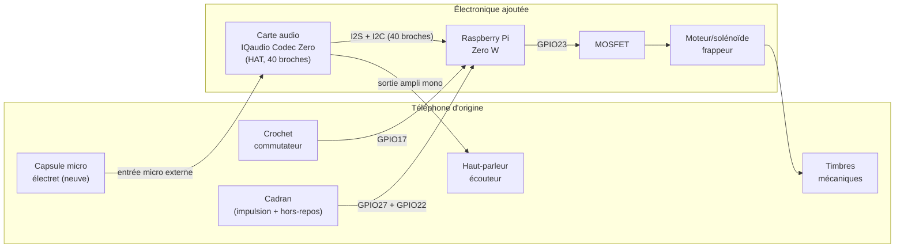

# Modifications matérielles

## Ce qu'on garde / ce qu'on remplace

| Élément d'origine | Décision | Pourquoi |
|---|---|---|
| Boîtier, combiné (mécanique), cadran, crochet commutateur | **Conservés tels quels** | Aspect et toucher d'origine préservés |
| Micro à charbon (dans le combiné) | **Remplacé** par une capsule électret, câblée sur l'entrée micro externe de la carte audio | Le micro carbone demande une polarisation DC particulière, incompatible avec une entrée son moderne |
| Écouteur (bobine dans le combiné) | À **mesurer** — réutilisable si son impédance est compatible avec la sortie ampli mono de la carte audio, sinon remplacé par un petit haut-parleur 8 Ω | Évite de casser une pièce d'origine si elle peut être réutilisée |
| Timbres mécaniques (les deux cloches) | **Conservés**, mais leurs bobines d'origine (~90 V AC / 25 Hz) sont débranchées | Trop dangereux/complexe à régénérer en toute sécurité pour 6 postes |
| — | **Ajout** d'un petit moteur vibrant ou solénoïde qui vient frapper mécaniquement les timbres | Reproduit le vrai son des cloches sans haute tension |
| Câblage interne (induction, batterie locale) | **Retiré** | Remplacé entièrement par le Raspberry Pi + électronique moderne |
| — | **Ajout** Raspberry Pi Zero W + carte audio IQaudio Codec Zero (HAT) + alimentation | Cerveau du poste |

> **Pourquoi le Zero W (original) plutôt que le Zero 2 W ?** Choix dicté
> par la disponibilité (le Zero 2 W était en rupture au moment du projet).
> Le Zero W a un seul cœur ARM11 (ARMv6) à 1 GHz au lieu d'un quad-cœur
> Cortex-A53 — largement suffisant ici puisque chaque poste ne gère
> qu'un seul appel SIP à la fois (pas de multi-appel/conférence en
> local). La seule vraie différence pratique : le Zero W est **32-bit
> uniquement** (ARMv6 ne supporte pas l'architecture 64-bit), donc il
> faut flasher **Raspberry Pi OS Lite en version 32-bit** et non 64-bit
> — voir `setup.md`. Le reste (brochage GPIO, code du daemon, config
> baresip/Ansible) est identique aux deux cartes.

## Interface audio : carte IQaudio Codec Zero (HAT I2S, recommandée)

Le poste utilise une carte **IQaudio Codec Zero** (produit officiel
Raspberry Pi Ltd, ex-IQaudio) : elle se branche directement sur le
connecteur 40 broches (I2S + I2C), sans passer par un port USB. Choisie
plutôt que la Waveshare DA7212 Audio Board (même puce codec DA7212)
pour simplifier le montage :

- **Prise jack 3.5mm mono dédiée pour le micro externe**, qui désactive
  automatiquement le micro MEMS embarqué dès qu'on y branche quelque
  chose. Pas de soudure sur un pad ambigu à identifier sur le PCB : on
  soude la capsule électret du combiné sur une fiche jack 3.5mm mono
  (ou directement sur les deux points de la prise si on préfère câbler
  sans connecteur amovible), et c'est prêt.
- **Ampli mono intégré, calibré pour un haut-parleur 8 Ω** (1.2 W) —
  correspond exactement au haut-parleur de remplacement prévu dans le
  BOM, sans avoir à deviner quel connecteur/canal utiliser.
- **Format 65×31 mm** — quasiment la taille du Pi Zero lui-même
  (65×30 mm), bien plus compact que la plupart des HAT audio génériques,
  donc plus facile à loger dans le boîtier du téléphone.
- **Support officiel Raspberry Pi** : overlay mainline
  `dtoverlay=rpi-codeczero` dans Raspberry Pi OS (voir
  [pinout.xyz/pinout/codec_zero](https://pinout.xyz/pinout/codec_zero)
  pour le brochage détaillé) — pas de pilote tiers à installer, moins de
  risque qu'avec un board moins documenté. **Aucun conflit** avec les
  GPIO déjà utilisés par le daemon (crochet=17, cadran=27/22,
  sonnerie=23 — l'I2S/I2C utilise d'autres broches).

Cette carte **élimine le besoin d'adaptateur/hub OTG** pour l'audio (elle
ne passe pas par le port USB, qui de toute façon n'existe pas en USB-A
sur le Zero W). L'adaptateur OTG ne reste nécessaire que si vous ajoutez
en plus un adaptateur USB-Ethernet (voir `software-architecture.md`) —
dans ce cas, un simple adaptateur micro-USB OTG (USB-A femelle → micro-USB
mâle) suffit puisque l'unique périphérique USB à brancher est alors
l'Ethernet, ex. [InLine Adaptateur Micro-USB OTG](https://www.galaxus.ch/fr/s1/product/inline-adaptateur-micro-usb-otg-usb-20-cable-usb-13265450) (~CHF 6-10).

Sources (~18-23 CHF selon fournisseur) : [The Pi Hut](https://thepihut.com/products/iqaudio-codec-zero),
[Kiwi Electronics](https://www.kiwi-electronics.com/en/iqaudio-codec-zero-10833) (livre en Suisse).
Produit plus ancien (retiré chez SparkFun) mais toujours activement
distribué ailleurs — vérifier le stock au moment de commander.

### Connecteurs confirmés sur la carte reçue

Carte en main (voir photo ci-dessus) — la sérigraphie confirme :

| Connecteur (sérigraphie sur le PCB) | Fonction | Usage dans ce projet |
|---|---|---|
| **Prise jack 3.5mm** (à côté du label "MIC2") | Entrée micro externe mono, désactive le micro MEMS embarqué à l'insertion | **Y souder la capsule électret du combiné** |
| Bornier à vis vert **"SPKR OUT"** (2 broches) | Sortie ampli mono | **Y câbler l'écouteur/haut-parleur 8 Ω** |
| Header vertical **"AUX IN"** (3 broches, bord gauche) | Entrée ligne stéréo | Non utilisé |
| Header vertical **"AUX OUT"** (près de "P2"/"D2") | Sortie ligne stéréo | Non utilisé |
| Bouton **"SW1"** + LEDs ("D1 PWR", "D2", "D3") | Bouton programmable + indicateurs | Non utilisés, peuvent rester cachés dans le boîtier |

⚠️ Avant de souder : confirmer la polarité/le brochage exact de la prise
jack (pointe = signal micro, ou l'inverse) avec le manuel IQaudio /
[pinout.xyz/pinout/codec_zero](https://pinout.xyz/pinout/codec_zero) —
la sérigraphie confirme l'existence et l'emplacement du connecteur, pas
le détail des broches internes du jack.

*(Alternatives envisagées et écartées : Waveshare DA7212 Audio Board —
même puce mais entrée micro externe ambiguë à localiser sur le PCB sans
la carte en main, voir `DA7212-Audio-Board-A-Schematics.pdf` conservé
dans ce dossier pour référence ; carte son USB + ampli PAM8403 séparés —
demande en plus un adaptateur/hub OTG. Voir l'historique du dépôt.)*

## Brochage GPIO (Raspberry Pi Zero W)

Numérotation **BCM**. À ajuster dans `gpio-daemon/config.example.yaml` et
dans l'inventaire Ansible si vous câblez différemment.

| Signal | GPIO (BCM) | Type | Notes |
|---|---|---|---|
| Crochet commutateur (hook) | GPIO17 | entrée, pull-up interne | fermé (décroché) = niveau bas |
| Cadran — contact d'impulsion | GPIO27 | entrée, pull-up interne | un front par impulsion pendant le retour du cadran |
| Cadran — contact "hors repos" (off-normal) | GPIO22 | entrée, pull-up interne | fermé pendant toute la durée où le cadran n'est pas au repos ; optionnel (voir ci-dessous) |
| Sortie frappeur de timbres | GPIO23 | sortie, vers MOSFET | pilote le moteur/solénoïde via un MOSFET (jamais directement, le GPIO ne fournit pas assez de courant) |

Si votre cadran n'a que **deux fils** (pas de contact "hors repos"
séparé), laissez `dial_off_normal: null` dans la config : le daemon
bascule automatiquement sur un décodage par **temporisation entre
impulsions** (`TimeoutDialDecoder`), légèrement moins robuste mais
fonctionnel — voir `gpio-daemon/gpio_daemon/dial_decoder.py`.

Tous les contacts mécaniques du téléphone (crochet, cadran) sont câblés
en tout-ou-rien entre le GPIO et la masse (GND) ; le pull-up interne du
Pi suffit, aucune résistance externe n'est nécessaire pour ces entrées.

## Circuit de pilotage du solénoïde (frappeur de timbres)

Un module relais a été envisagé un temps pour piloter le solénoïde
depuis `GPIO23`, mais les modules relais courants (même "1 canal") sont
nettement plus volumineux qu'un simple MOSFET — peu adapté à l'espace
réduit dans le boîtier du téléphone. On reste donc sur un MOSFET
discret, minuscule (boîtier TO-220), silencieux et increvable pour les
cycles répétés de la cadence de sonnerie :

| Composant | Référence | Rôle |
|---|---|---|
| MOSFET N logic-level | [Infineon IRLZ44NPBF, TO-220](https://www.distrelec.ch/fr/mosfet-kanal-55v-47a-to-220-infineon-irlz44npbf/p/30341412) — Distrelec réf. **30341412** | commuté par `GPIO23` (seuil de grille compatible 3.3V), fait passer le courant du solénoïde |
| Diode de roue libre | [Diotec 1N4007, DO-41](https://www.distrelec.ch/fr/diode-de-redressement-1kv-1a-do-41-diotec-1n4007/p/11052628) — Distrelec réf. **11052628** | protège le MOSFET contre la surtension générée par le solénoïde à la coupure (indispensable avec une charge inductive) |
| Résistance de grille/pull-down | ~220 Ω en série + ~10 kΩ entre grille et GND | limite le courant d'appel et évite que le MOSFET ne s'active de façon erratique au démarrage du Pi (GPIO flottant) — composant générique, pas de référence dédiée nécessaire |

Câblage : `GPIO23` → résistance 220 Ω → grille du MOSFET (+ résistance
10 kΩ grille→GND) ; drain du MOSFET → une borne du solénoïde ; l'autre
borne du solénoïde → +5V ; source du MOSFET → GND. La diode 1N4007 se
place en parallèle du solénoïde (cathode côté +5V, anode côté drain).

## Schéma de principe

## Alimentation

- Le Raspberry Pi Zero W consomme peu (~0.5-1 W au repos, pics à ~1.5 W —
  encore moins que le Zero 2 W, son unique cœur ARM11 étant plus sobre)
  mais demande une alimentation 5V stable — utilisez un vrai bloc
  micro-USB 5V/2.5A, pas un chargeur de téléphone bas de gamme (chutes de
  tension = redémarrages aléatoires).
- Deux options :
  1. **Simple** : bloc secteur USB caché dans/derrière le boîtier, câble
     sortant discrètement par le trou de câble d'origine.
  2. **Plus propre pour une installation fixe (ex. salle d'escape game)** :
     alimentation par PoE via un splitter PoE→micro-USB (~10 €) et un câble
     Ethernet, qui apporte aussi le réseau filaire (recommandé si le Wi-Fi
     est saturé — voir `software-architecture.md`).

## Points à valider sur le premier prototype avant de dupliquer

1. **Impédance de l'écouteur d'origine** au multimètre — décide s'il est
   réutilisable tel quel derrière l'ampli mono de la carte Codec Zero ou
   s'il faut un haut-parleur de remplacement.
2. **Force nécessaire pour faire sonner les timbres** de façon audible
   sans les endommager — choisir le moteur/solénoïde en conséquence
   (commencer par un petit solénoïde 5V à faible course, ajuster si le
   son est trop faible).
3. ~~Espace disponible dans le boîtier~~ — ✅ carte Codec Zero reçue et
   comparée physiquement au Pi Zero (voir photo ci-dessus), gabarit
   confirmé compact.
4. **Brochage exact de la prise jack micro** (pointe/corps) — à confirmer
   avec le manuel IQaudio avant de souder la capsule électret.
