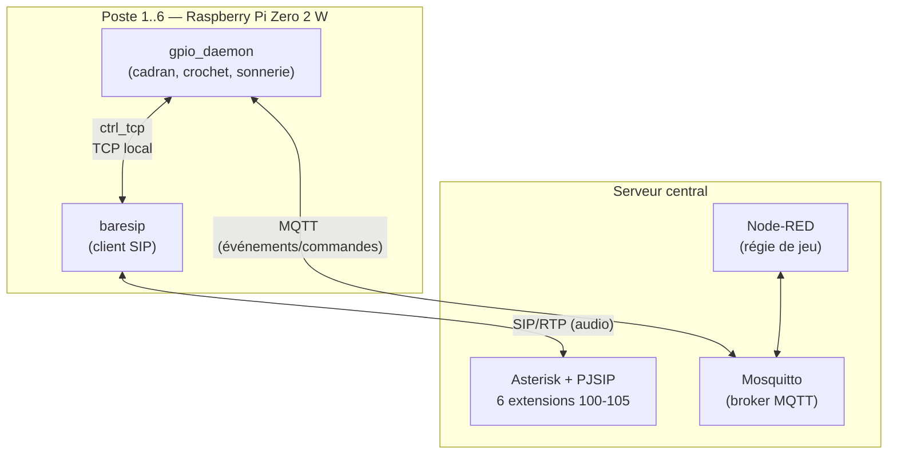

# Architecture logicielle

## Pourquoi ces choix

- **baresip** plutôt que Linphone : client SIP très léger (adapté au Pi
  Zero 2 W), scriptable via son module `ctrl_tcp` — pas d'interface
  graphique à faire tourner en headless.
- **Asterisk central** plutôt que du SIP pair-à-pair direct entre postes :
  donne un vrai plan de numérotation (ex. `_10[0-5]` pour appeler un
  poste par son extension), la possibilité de sonner plusieurs postes à
  la fois, et un point d'intégration (AMI) pour que la régie de jeu
  puisse déclencher des appels/annonces automatiquement.
- **MQTT** comme bus d'événements séparé de la voix : la régie de jeu n'a
  pas besoin de comprendre SIP pour réagir à "le joueur a composé 1958
  sur le poste 3" — elle écoute juste un topic MQTT.
- **Node-RED** pour la régie : standard de facto pour le pilotage DIY
  d'escape games (flows visuels, dashboard, intégration MQTT native).

## Topics MQTT

| Topic | Sens | Payload | Retenu (retain) |
|---|---|---|---|
| `phone/<id>/state` | poste → régie | `{"hook": "onhook"\|"offhook"}` | oui |
| `phone/<id>/digit` | poste → régie | `{"digit": 0-9, "buffer": "<chiffres composés jusqu'ici>"}` | non |
| `phone/<id>/call_state` | poste → régie | événement brut relayé depuis baresip (`ctrl_tcp`) — schéma exact dépendant de la version de baresip, voir avertissement dans `gpio_daemon/baresip_client.py` | non |
| `phone/<id>/cmd/ring` | régie → poste | vide/quelconque : déclenche la sonnerie (frappeur de timbres) | non |
| `phone/<id>/cmd/ring_stop` | régie → poste | vide/quelconque : arrête la sonnerie | non |

`<id>` est l'identifiant du poste (ex. `phone01`…`phone06`), défini dans
`gpio-daemon/config.example.yaml` / l'inventaire Ansible.

## Comportement "appel automatique" vs "code de jeu"

Le daemon (`gpio_daemon/service.py`) publie **chaque chiffre composé** sur
MQTT dès qu'il est décodé — la régie de jeu peut donc réagir en temps réel
à une séquence de n'importe quelle longueur (ex. un code à 4 chiffres pour
une énigme).

En parallèle, dès que `dial_digit_count` chiffres ont été composés
(3 par défaut, pour matcher les extensions 100-105), le daemon lance
automatiquement l'appel SIP correspondant via baresip — le téléphone se
comporte donc aussi comme un vrai poste interne, sans configuration
supplémentaire. Ajustez `dial_digit_count` dans la config si votre plan
de numérotation change.

## Réseau : Wi-Fi ou Ethernet ?

Le Pi Zero 2 W a le Wi-Fi intégré, ce qui simplifie beaucoup
l'installation (pas de câble à faire courir jusqu'à chaque téléphone).
C'est suffisant dans la plupart des cas. Si vous constatez de la gigue
audio ou des coupures pendant un événement (plusieurs postes actifs en
même temps, Wi-Fi du lieu saturé), passez à un adaptateur USB-Ethernet
par poste (voir `bom.md`) — plus fiable pour du SIP/RTP en usage intensif.
